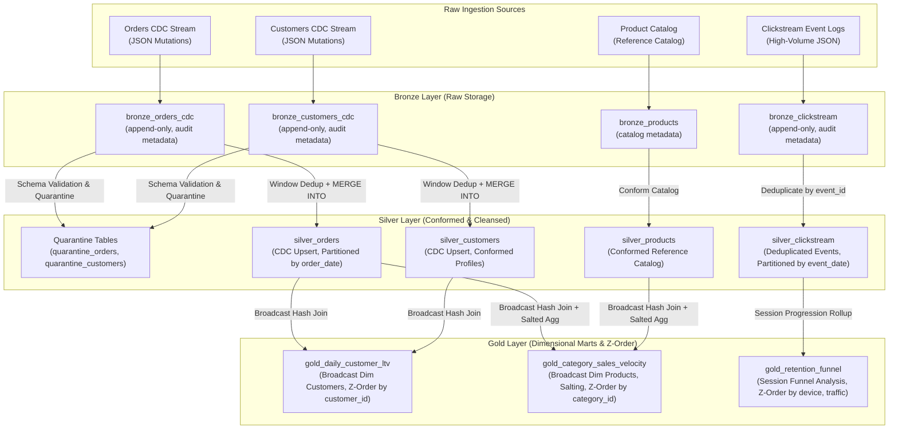

# Enterprise E-Commerce & Clickstream Lakehouse Engine

[](https://www.python.org/downloads/)
[](https://delta.io/)
[](https://spark.apache.org/)
[](https://docs.databricks.com/dev-tools/bundles/index.html)
[](LICENSE)

An enterprise-grade, end-to-end Lakehouse data platform built with **PySpark**, **Delta Lake**, and **Databricks Best Practices** following the **Medallion Architecture (Bronze → Silver → Gold)**.

The platform ingests high-volume raw transactional Change Data Capture (CDC) streams and user clickstream event logs, processes mutations idempotently using Delta Lake ACID `MERGE INTO`, enforces strict data quality and quarantine governance, and generates high-performance dimensional analytical marts optimized for downstream BI and data science workloads.

---

## Architecture Overview



---

## Key Engineering Highlights

### 1. Medallion Architecture Progression

| Layer | Responsibility | Storage Strategy | Key Governance Features |
| :--- | :--- | :--- | :--- |
| **Bronze** | Raw Ingestion | Delta Lake (`delta.appendOnly=true`) | Adds `_ingest_timestamp`, `_source_file`, and handles schema drift via `_rescued_data`. |
| **Silver** | Conformed, Cleansed & CDC Upsert | Delta Lake (Partitioned & Clustered) | Strict schema validation, quarantine routing, window deduplication, and ACID `MERGE INTO` (INSERT, UPDATE, DELETE). |
| **Gold** | Dimensional KPI Marts | Delta Lake (`OPTIMIZE` + `Z-ORDER BY`) | Star-schema analytical marts, broadcast hash joins, and session-level user retention funnels. |

### 2. ACID CDC Upserts & Out-of-Order Handling

In high-throughput distributed systems, CDC mutation packets can arrive out-of-order due to network latency, partition rebalancing, or retries. Additionally, multiple mutations for the same entity may arrive in the same micro-batch.

The engine guarantees idempotency and consistency via:
1. **In-Batch Window Deduplication**: Uses `ROW_NUMBER() OVER (PARTITION BY business_key ORDER BY _change_seq DESC, event_timestamp DESC)` to isolate the latest event within each incoming batch.
2. **State-Aware `MERGE INTO`**:
   ```sql
   MERGE INTO silver_orders AS target
   USING batch_latest AS source
   ON target.order_id = source.order_id
   WHEN MATCHED AND source.op_type = 'DELETE' AND source._change_seq >= target._change_seq THEN
     DELETE
   WHEN MATCHED AND source.op_type != 'DELETE' AND source._change_seq >= target._change_seq THEN
     UPDATE SET *
   WHEN NOT MATCHED AND source.op_type != 'DELETE' THEN
     INSERT *
   ```
   *Any late-arriving event with `source._change_seq < target._change_seq` is safely rejected without corrupting the committed state.*

### 3. PySpark Performance & Distributed Compute Optimization

- **Broadcast Hash Joins (`F.broadcast`)**: Applied to dimensional tables (`silver_products`, `silver_customers`) when joining against massive fact tables (`silver_orders`, `silver_clickstream`). Eliminates expensive Shuffle Sort-Merge Joins and network exchange stages.
- **Key Skew Salting Utility (`src/utils/skew_handler.py`)**:
  - Automatically diagnoses skew factor across key distributions (`detect_key_skew`).
  - Distributes hot keys across $N$ salt buckets to execute two-stage partial aggregations (`execute_salted_aggregation`), eradicating straggler tasks and executor OOMs.
  - Implements salted joins (`salted_join`) by replicating dimensions across salt buckets.
- **Shuffle & Partition Tuning**:
  - Dynamically sets `spark.sql.shuffle.partitions`.
  - Configures Adaptive Query Execution (AQE): dynamic partition coalescing (`spark.sql.adaptive.coalescePartitions.enabled`) and skew join handling (`spark.sql.adaptive.skewJoin.enabled`).

### 4. Delta Lake Production Governance

- **Compaction & Multi-Dimensional Clustering**: Eliminates the "small files problem" by executing `OPTIMIZE` combined with `Z-ORDER BY` on high-cardinality query keys (`customer_id`, `category_id`, `device_type`).
- **ACID Time Travel & Audit Log**: Retains complete commit transaction logs (`_delta_log`), enabling historical snapshot auditing (`versionAsOf`, `timestampAsOf`) and instant point-in-time disaster recovery (`RESTORE TABLE ... TO VERSION`).
- **Schema Evolution Controls**: Enforces strict schema governance by default while providing controlled evolution using `.option("mergeSchema", "true")`.

---

## Directory Structure

```text
├── configs/
│   └── pipeline_config.yaml         # Environment paths, partition strategies, Z-order keys
├── data/                            # Sample raw data (CDC events + high-volume clicks)
│   └── raw/
│       ├── orders_cdc/              # Order mutation stream (I, U, D, out-of-order, malformed)
│       ├── customers_cdc/           # Customer profile mutation stream
│       ├── clickstream/             # User session clickstream events
│       └── products/                # Product catalog reference data
├── src/
│   ├── utils/
│   │   ├── spark_session.py         # Delta-enabled Spark session builder (Local & Databricks)
│   │   ├── skew_handler.py          # Salting functions & two-stage aggregation for skewed keys
│   │   └── delta_utils.py           # OPTIMIZE, Z-ORDER, VACUUM, and Time Travel utilities
│   ├── bronze/
│   │   └── ingest_raw.py            # Append-only raw ingestion with audit & rescued data
│   ├── silver/
│   │   └── transform_silver.py      # Cleansing, quarantine, CDC deduplication & MERGE INTO
│   └── gold/
│       └── build_gold_marts.py      # Dimensional aggregates, broadcast joins, Z-ordering
├── scripts/
│   ├── generate_sample_data.py      # Generates realistic CDC and clickstream test datasets
│   └── demo_time_travel_and_evolution.py # Interactive demo of Time Travel, Rollback & Evolution
├── tests/
│   ├── conftest.py                  # Pytest SparkSession & isolated Delta fixtures
│   ├── test_transformations.py      # Test suite validating CDC merges, schemas & quarantines
│   └── test_skew_handler.py         # Test suite validating skew detection & salting accuracy
├── databricks.yml                   # Databricks Asset Bundle (DAB) declaration
├── docker-compose.yml               # Containerized local execution
├── Dockerfile                       # Multi-stage image with OpenJDK 17 and Python 3.10
├── pyproject.toml / requirements.txt# Project packaging and dependency specifications
└── README.md
```

---

## Quickstart & Local Execution

### 1. Prerequisites
- **Python**: 3.10+
- **Java**: OpenJDK 17 or 11
- **uv** / **pip** / **Docker**

### 2. Environment Setup

```bash
# Create and activate virtual environment
uv venv .venv --python 3.10
source .venv/bin/activate

# Install dependencies
uv pip install -r requirements.txt --python .venv/bin/python
```

### 3. Generate Sample Datasets
Generate realistic raw CDC and clickstream data with intentional mutations, out-of-order events, and malformed rows:

```bash
python scripts/generate_sample_data.py
```

### 4. Run the Full Lakehouse Pipeline (Bronze → Silver → Gold)

```bash
python run_pipeline.py
```

Expected output:
```text
>>> [1/3] EXECUTING BRONZE LAYER (RAW INGESTION)...
[Bronze] Successfully ingested 65 records into data/lakehouse/bronze/bronze_orders_cdc
[Bronze] Successfully ingested 32 records into data/lakehouse/bronze/bronze_customers_cdc
[Bronze] Successfully ingested 230 records into data/lakehouse/bronze/bronze_clickstream
[Bronze] Successfully ingested 20 records into data/lakehouse/bronze/bronze_products

>>> [2/3] EXECUTING SILVER LAYER (CONFORMING, CDC MERGE, DEDUPLICATION)...
[Silver] Quarantined 1 invalid order records.
[Silver] silver_orders successfully merged: 59 active records.
[Silver] Quarantined 1 invalid customer records.
[Silver] silver_customers successfully merged: 30 active records.
[Silver] silver_clickstream successfully merged: 230 records.
[Silver] silver_products conformed: 20 records.

>>> [3/3] EXECUTING GOLD LAYER (ANALYTICAL MARTS, BROADCAST JOINS, Z-ORDER)...
[Gold] Running OPTIMIZE and Z-ORDER BY ['customer_id'] on data/lakehouse/gold/gold_daily_customer_ltv...
[Gold] gold_daily_customer_ltv generated: 40 records.
[Gold] Running OPTIMIZE and Z-ORDER BY ['category_id'] on data/lakehouse/gold/gold_category_sales_velocity...
[Gold] gold_category_sales_velocity generated: 10 records.
[Gold] Running OPTIMIZE and Z-ORDER BY ['device_type', 'traffic_source'] on data/lakehouse/gold/gold_retention_funnel...
[Gold] gold_retention_funnel generated: 29 records.
```

### 5. Run the Automated Test Suite

```bash
pytest tests/
```
*All 11 unit & integration tests validate transformations, CDC merges, late-arrival isolation, and key salting.*

### 6. Run Delta Lake ACID, Time Travel & Schema Evolution Demo

```bash
python scripts/demo_time_travel_and_evolution.py
```

Demonstrates:
- **ACID Commit History**: Audits historical transaction logs.
- **Time Travel Query**: Queries point-in-time state using `versionAsOf(1)`.
- **Disaster Rollback**: Reverts corrupted data state using `RESTORE TABLE ... TO VERSION 1`.
- **Strict Schema Enforcement**: Blocks unapproved columns.
- **Controlled Evolution**: Safely adopts new columns with `.option("mergeSchema", "true")`.
- **Storage Compaction**: Clusters fragmented files using `OPTIMIZE ... ZORDER BY`.

---

## Databricks Asset Bundle (DAB) Deployment

Deploy to Databricks using the bundle CLI:

```bash
# 1. Validate Databricks bundle configuration
databricks bundle validate -t dev

# 2. Deploy bundle resources to your Databricks workspace
databricks bundle deploy -t dev

# 3. Trigger the orchestrated pipeline job
databricks bundle run medallion_pipeline_workflow -t dev
```

---

## Docker Execution

Run the complete pipeline or test suite in an isolated container:

```bash
# Build and run the pipeline
docker compose up lakehouse-pipeline

# Run the test suite in container
docker compose up lakehouse-tests
```
